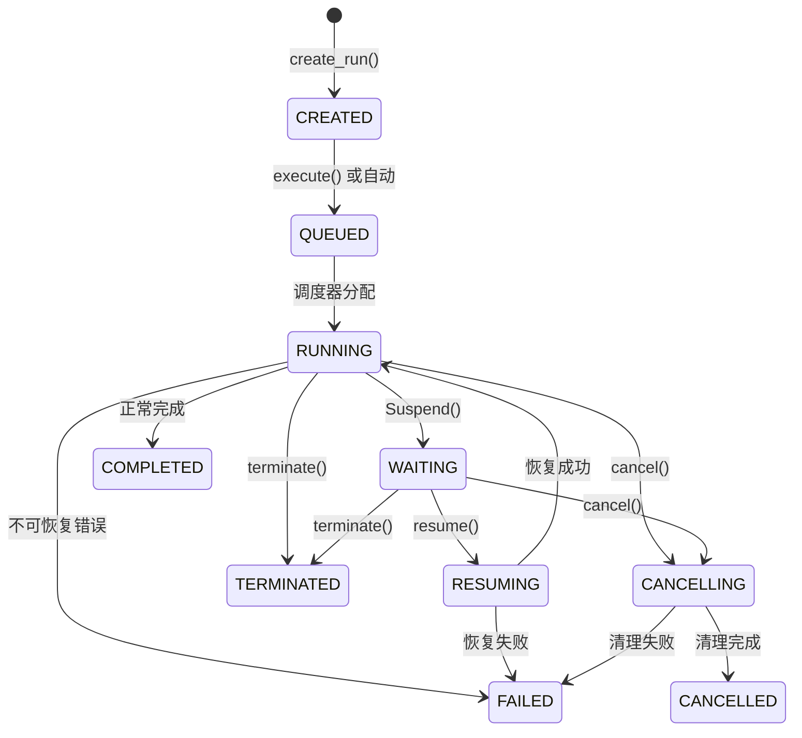

# Runtime Adapter 详细设计文档

> 本文档基于 Pi、OpenAI Agents SDK、LangGraph、PydanticAI、smolagents、Temporal Python SDK、MCP Python SDK 的源码调研，为 Shorekeeper 项目输出可直接指导开发的 Runtime Adapter 工程级设计。

---

## 1. 执行摘要

### 主推荐方案

| 决策项 | 推荐 |
|---|---|
| **Runtime** | Native Python Runtime（自研） |
| **Agent Loop** | 自研，~150-200 行核心循环，借鉴 smolagents 最小循环 + PydanticAI 审批模式 |
| **模型调用** | LiteLLM（既定依赖，不重复抽象） |
| **持久化** | SQLite，Snapshot + Event Log |
| **事件机制** | 类型化 discriminated union，借鉴 PydanticAI 事件模型 |
| **工具执行** | 独立 ToolExecutor，支持并行/串行、审批拦截、副作用等级 |
| **暂停恢复** | Checkpoint + Pending Writes，借鉴 LangGraph 模式简化版 |
| **第一个第三方 Adapter** | OpenAI Agents SDK Adapter（能力最接近，有现成审批机制） |
| **Pi 的定位** | 设计参考，不作为 Runtime 接入 |
| **LangGraph 的定位** | 设计参考（checkpoint/resume 模式），不作为核心依赖 |
| **Temporal 的引入时机** | 第二阶段，当需要分布式 durable execution 时 |

### 核心原则

1. **Runtime 核心保持小型**：Agent Loop + 状态机 + 事件发布，不超过 500 行核心代码
2. **不伪造底层能力**：Adapter 声明真实 capability 等级，不支持的标记为不支持
3. **Suspension 必须可持久化**：进程退出后可恢复，不依赖协程存活
4. **Tool Executor 独立于 Runtime**：Runtime 调度，Executor 执行，职责分离
5. **Observer 与控制流拦截分离**：事件通知不阻塞循环，拦截器必须返回决策

---

## 2. 调研范围、版本与证据

### 调研项目

| 项目 | 仓库 | 版本/Commit | 调研日期 | 证据等级 |
|---|---|---|---|---|
| Pi | github.com/earendil-works/pi | v0.83.0 | 2026-07-30 | [源码确认] |
| OpenAI Agents SDK | github.com/openai/openai-agents-python | main branch | 2026-07-30 | [源码确认] |
| LangGraph | github.com/langchain-ai/langgraph | main branch | 2026-07-30 | [源码确认] |
| PydanticAI | github.com/pydantic/pydantic-ai | main branch | 2026-07-30 | [源码确认] |
| smolagents | github.com/huggingface/smolagents | main branch | 2026-07-30 | [源码确认] |
| Temporal Python SDK | github.com/temporalio/sdk-python | main branch | 2026-07-30 | [源码确认] |
| MCP Python SDK | github.com/modelcontextprotocol/python-sdk | main branch | 2026-07-30 | [源码确认] |

### 关键源码路径

| 项目 | 关键文件 |
|---|---|
| Pi | `packages/agent/src/agent-loop.ts`, `packages/agent/src/types.ts`, `packages/coding-agent/src/core/session-manager.ts` |
| OpenAI Agents SDK | `src/agents/run.py`, `src/agents/run_internal/run_loop.py`, `src/agents/run_state.py`, `src/agents/lifecycle.py` |
| LangGraph | `libs/langgraph/langgraph/pregel/_loop.py`, `libs/langgraph/langgraph/types.py`, `libs/checkpoint/langgraph/checkpoint/base/__init__.py` |
| PydanticAI | `pydantic_ai_slim/pydantic_ai/_agent_graph.py`, `pydantic_ai_slim/pydantic_ai/_tool_execution.py`, `pydantic_ai_slim/pydantic_ai/messages.py` |
| smolagents | `src/smolagents/agents.py`, `src/smolagents/memory.py` |
| Temporal | `temporalio/worker/_workflow_instance.py`, `temporalio/activity.py` |

---

## 3. 各项目核心运行语义

### 3.1 Pi

**Agent Loop**：双嵌套循环（外层 follow-up，内层 tool calls + steering）。核心在 `agent-loop.ts:155-275`。无显式 max turns，依赖 `shouldStopAfterTurn` 钩子和 `AbortSignal`。工具支持并行/串行。[源码确认]

**事件系统**：`AgentEvent` discriminated union（agent_start/end, turn_start/end, message_start/update/end, tool_execution_start/update/end）。事件在状态变更后发出，监听器被 await。监听器返回值不被消费。[源码确认]

**中断控制**：`beforeToolCall` 钩子可阻塞工具执行（返回 `{block: true}`）。但这是进程内阻塞，不支持 durable suspension。`abort()` 通过 AbortSignal 退出循环。无 pause/resume 机制。[源码确认]

**状态管理**：Session = append-only JSONL 文件。每条消息完成即持久化。重启后从 JSONL 重建消息历史。工具执行中间状态不可恢复。[源码确认]

**Python 接入**：RPC 模式（stdin/stdout JSON-Lines）是最实用的接入方式。但 RPC 模式不暴露 `beforeToolCall` 钩子，无法实现阻塞审批。[源码确认]

### 3.2 OpenAI Agents SDK

**Runner 主循环**：`while True` 在 `run.py:789`。每轮：guardrail setup → `run_single_turn()` → step resolution（FinalOutput/Handoff/RunAgain/Interruption）。默认 max_turns=10。[源码确认]

**Hooks**：所有 hooks（on_agent_start/end, on_tool_start/end, on_llm_start/end）都是 Observer，返回 None，不能修改数据。Hook 异常会中止 Run。[源码确认]

**Guardrails**：Input/Output guardrails 只能拒绝（tripwire）。Tool Input/Output guardrails 可以拒绝并替换为消息（reject_content）。[源码确认]

**审批**：`needs_approval` 字段支持静态 bool 或动态 callable。审批暂停通过 `NextStepInterruption` + `RunState` 实现。`RunState` 可序列化，支持跨进程恢复。[源码确认]

**Session**：`Session` Protocol 支持 `get_items()`/`add_items()`。实现包括 SQLite 和 OpenAI Conversations。Session 只存消息历史，不存 RunState。[源码确认]

### 3.3 LangGraph

**执行模型**：BSP（Bulk Synchronous Parallel）模型。每个 superstep：prepare tasks → execute tasks → apply writes → checkpoint。Channel 在 step 内不可变，step 间原子更新。[源码确认]

**Checkpoint**：保存 `channel_values`, `channel_versions`, `versions_seen`。Pending writes 与 checkpoint 分离，任务完成即写入。支持外部存储（PostgreSQL/SQLite）。[源码确认]

**Interrupt/Resume**：`interrupt()` 函数在节点内抛出 `GraphInterrupt`。Resume 通过 `Command(resume=value)`。**关键：恢复时节点从头重新执行**，要求中断前的副作用幂等。多个 interrupt 通过 scratchpad 计数器区分。[源码确认]

**可借鉴**：checkpoint-per-step 模式、pending writes 分离、versions_seen 触发去重、scratchpad 中断跟踪。[源码确认]

**不应引入**：Channel 系统、Pregel 超步模型、图拓扑、Send/PUSH 任务。[源码确认]

### 3.4 PydanticAI

**Agent Run**：基于 `pydantic_graph` 的图执行。三个节点：`UserPromptNode` → `ModelRequestNode` → `CallToolsNode` 循环。`iter()` 是最低级 API。[源码确认]

**RunContext**：混合运行时状态（usage, retries, run_step）和业务依赖（deps）。共享可变引用。[源码确认]

**Tool 系统**：`requires_approval=True` 触发 `ApprovalRequired` 异常。Run 以 `DeferredToolRequests` 结束。恢复时传入 `DeferredToolResults`。**这是最干净的 durable approval 模式**。[源码确认]

**Event 模型**：`AgentStreamEvent` discriminated union，包含 `PartStartEvent`, `PartDeltaEvent`, `FunctionToolCallEvent`, `DeferredToolRequestsEvent` 等。类型完整，适合序列化。[源码确认]

**Durable Execution**：通过 capability 模式集成 Temporal/DBOS/Prefect。Model 请求和工具调用是独立的 durable unit。消息历史是 checkpoint 的核心。[源码确认]

### 3.5 smolagents

**核心循环**：`_run_stream()` 在 `agents.py:540-611`，约 70 行。同步 Generator。每步：planning（可选）→ action → finalize → yield。[源码确认]

**ToolCallingAgent vs CodeAgent**：共享循环，差异在执行器。ToolCallingAgent 用模型原生 tool_calls，CodeAgent 用代码解释器。支持 ThreadPoolExecutor 并行工具。[源码确认]

**Callback**：同步，不被 await。Callback 可通过 `agent.interrupt()` 设置中断标志，但只在下一步生效。不支持暂停/恢复。[源码确认]

**可借鉴**：Step dataclasses（ActionStep, PlanningStep）、CallbackRegistry、Error hierarchy、最小循环结构。[源码确认]

### 3.6 Temporal Python SDK

**确定性要求**：Workflow 实现 `asyncio.AbstractEventLoop`，所有 async 操作通过自定义事件循环。时间来自历史，随机数来自种子。[源码确认]

**Activity 边界**：Activity 是唯一允许副作用的地方。Workflow 必须确定性。[源码确认]

**外部控制**：Signal（持久化、fire-and-forget、可修改状态）、Query（只读）、Update（验证+执行+返回值）。Cancel（协作式，可清理）、Terminate（硬杀）。[源码确认]

**等待恢复**：`wait_condition` 暂停 → Worker 退出 → 新 Worker 重放历史 → 重建状态 → 在相同 await 点暂停。所有代码从头重执行，但已完成的 Activity 从历史获取结果。[源码确认]

**可借鉴**：Activity 副作用边界、Signal 模式、wait_condition 模式、幂等要求。[源码确认]

**不应引入**：完整重放引擎、Sandbox、Child Workflow、Versioning。[源码确认]

### 3.7 MCP Python SDK

**Tool Discovery**：`list_tools()` 返回 `ListToolsResult`（纯数据快照，可缓存、可 diff）。[源码确认]

**Tool Invocation**：`call_tool(name, arguments)` → `CallToolResult`。支持 progress callback。[源码确认]

**Cancellation**：courtesy 模式（发送 `notifications/cancelled`），两种模式（interrupt/signal）。已取消的请求永不被回答。[源码确认]

**Elicitation**：`InputRequiredResult` 模式——服务器暂停工具调用，客户端解析输入，重试。三个结果：accept/decline/cancel。`request_state` 是恢复令牌。[源码确认]

**设计建议**：Runtime 不应直接感知 MCP。Tool Adapter 在 `Dispatcher` 级别抽象，不持有 session 引用。[源码确认]

---

## 4. 横向专题对比

### 4.1 Agent Loop

| 维度 | Pi | OpenAI SDK | LangGraph | PydanticAI | smolagents |
|---|---|---|---|---|---|
| 核心状态 | AgentMessage[] | generated_items + session_items | Channel values | GraphAgentState | AgentMemory.steps |
| 一次 step | turn (LLM + tools) | turn (LLM + tools + guardrails) | superstep (parallel tasks) | node (ModelRequest or CallTools) | action step |
| final output | stopReason + shouldStopAfterTurn | NextStepFinalOutput | graph END node | FinalResult in CallToolsNode | is_final_answer flag |
| tool call 调度 | 并行/串行可配置 | 并行（函数工具） | 并行（PregelRunner） | 并行 + sequential barrier | ThreadPoolExecutor 并行 |
| max turns | 无显式限制 | DEFAULT_MAX_TURNS=10 | max_steps | 通过 UsageLimits | max_steps=20 |
| retry | auto_retry (LLM 级) | model retry with backoff | task retry policy | tool-level retry | 无 |

**推荐的 Native Python Runtime 循环结构**：

```python
# 最小 Agent Loop 伪代码
async def run_loop(run: Run, llm: LiteLLMClient, tools: ToolExecutor):
    for step_num in range(run.max_steps):
        # 1. Checkpoint: step 开始
        await checkpoint(run, step_num)
        
        # 2. 模型请求
        response = await llm.stream_completion(
            build_request(run.messages, run.tools),
            cancellation=run.cancellation_token,
        )
        
        # 3. 收集流式事件
        async for event in response:
            await publish_event(run, event)
        
        # 4. 判断 final answer 或 tool calls
        if response.stop_reason == "stop":
            await publish_event(run, RunCompleted(...))
            return
        
        # 5. 对每个 tool call 执行 interceptor
        for tool_call in response.tool_calls:
            decision = await interceptors.before_tool_call(run, tool_call)
            match decision:
                case Allow(): pass
                case Modify(args=): tool_call.arguments = args
                case Reject(reason=): 
                    run.messages.append(tool_result(tool_call, reason, is_error=True))
                    continue
                case Replace(result=):
                    run.messages.append(tool_result(tool_call, result))
                    continue
                case Suspend(request=):
                    await suspend(run, request)
                    return  # 协程正常退出
        
        # 6. 调度工具（并行）
        results = await tools.execute_parallel(response.tool_calls, run.context)
        
        # 7. 持久化工具结果
        run.messages.extend(results)
        
        # 8. Checkpoint: step 完成
        await checkpoint(run, step_num)
    
    raise MaxStepsExceeded(run.max_steps)
```

**属于 Runtime 的逻辑**：循环控制、状态机转换、事件发布、checkpoint、suspend/resume、cancel。
**属于 Tool Executor 的逻辑**：工具发现、参数校验、工具执行、timeout、retry、progress。
**属于 LiteLLM 的逻辑**：Provider 抽象、消息格式转换、流式解析、token 计数、重试。

### 4.2 Observer、Interceptor 和 Suspension

| 项目 | Observer | Blocking Interceptor | 可修改输入 | 可拒绝 | 可替换结果 | Durable Suspension |
|---|---|---|---|---|---|---|
| Pi | Agent.subscribe() | beforeToolCall hook | ✅ (extension) | ✅ | ✅ (extension) | ❌ |
| OpenAI SDK | RunHooks (all) | needs_approval + RunState | ❌ (hooks) | ✅ (guardrails) | ✅ (tool guardrails) | ✅ (RunState 序列化) |
| LangGraph | stream events | interrupt() | ❌ | ✅ | ❌ | ✅ (checkpoint + resume) |
| PydanticAI | stream events | requires_approval | ❌ | ✅ | ❌ | ✅ (DeferredToolRequests) |
| smolagents | callbacks | ❌ | ❌ | ❌ | ❌ | ❌ |
| Temporal | queries | wait_condition + signal | ✅ (signal) | ✅ | ✅ (signal) | ✅ (history replay) |

**严格区分**：

- **Observer**：只观察事件，不影响执行。所有 hooks 返回 None。
- **Blocking Interceptor**：位于关键执行路径，Runtime 必须等待返回。支持 Allow/Modify/Reject/Replace/Suspend。
- **Durable Suspension**：保存恢复所需状态 → Run 进入持久化等待 → 当前协程可结束 → 进程可退出 → 之后通过外部输入恢复。

### 4.3 Checkpoint 和恢复

| 项目 | 保存的数据 | 保存时机 | 恢复粒度 | 是否重放 | 跨进程 | 跨重启 |
|---|---|---|---|---|---|---|
| Pi | JSONL 消息历史 | 每条消息完成 | 消息级 | 从消息重建 | ✅ | ✅ |
| OpenAI SDK | RunState (全量快照) | on_state 回调 | Run 级 | 从 snapshot 恢复 | ✅ | ✅ |
| LangGraph | checkpoint + pending_writes | 每个 superstep | 节点级 | 从头重执行节点 | ✅ | ✅ |
| PydanticAI | 消息历史 + DeferredToolRequests | 每步完成 | Step 级 | 从消息重建 | ✅ | ✅ |
| Temporal | Event History | 每个 Activity/Timer | Workflow 级 | 从头重执行 Workflow | ✅ | ✅ |

**推荐的 checkpoint 策略**（借鉴 LangGraph 简化版）：

```python
@dataclass
class Checkpoint:
    id: str                    # UUID6, 单调递增
    run_id: RunId
    step: int                  # 步骤号
    state: RunSnapshot         # Run 状态快照
    pending_writes: list[PendingWrite]  # 已完成但未合并的写入
    timestamp: datetime
    schema_version: int
```

**Checkpoint 创建时机**：
1. Run 创建后（step=-1）
2. 每个 Agent Loop step 完成后
3. Suspension 写入后
4. 状态转换时

### 4.4 Streaming Event

| 事件类别 | Pi | OpenAI SDK | PydanticAI | 推荐映射 |
|---|---|---|---|---|
| token delta | message_update | RawResponsesStreamEvent | PartDeltaEvent | ModelTextDelta |
| tool call start | tool_execution_start | tool_called | FunctionToolCallEvent | ToolCallProposed |
| tool call progress | tool_execution_update | ❌ | ❌ | ToolExecutionProgress |
| tool call end | tool_execution_end | tool_output | FunctionToolResultEvent | ToolExecutionCompleted |
| thinking | thinking_delta | reasoning_item_created | ThinkingPartDelta | ModelReasoningDelta |
| state change | ❌ | AgentUpdatedStreamEvent | ❌ | RunStateChanged |
| final result | agent_end | RunResult | AgentRunResultEvent | RunCompleted |

**持久化策略**：
- **需要持久化**：RunCreated, RunStarted, RunCompleted, RunFailed, RunSuspended, RunResumed, ToolCallProposed, ToolExecutionCompleted, CheckpointCreated
- **实时 UI only（不持久化）**：ModelTextDelta, ModelReasoningDelta, ToolExecutionProgress
- **可丢弃**：重复的 token delta（合并后丢弃）

### 4.5 Cancellation

| 维度 | Cancel | Terminate |
|---|---|---|
| 语义 | 协作式停止，允许清理 | 硬杀，不允许清理 |
| 类比 | Temporal Cancel, Pi abort | Temporal Terminate |
| 工具执行 | 传递 CancellationToken | 直接 kill |
| Run 状态 | CANCELLING → CANCELLED | TERMINATED |
| 可恢复 | 否（terminal state） | 否（terminal state） |
| 幂等 | ✅ 重复 cancel 不报错 | ✅ 重复 terminate 不报错 |

### 4.6 Tool Execution

| 维度 | Pi | OpenAI SDK | PydanticAI | 推荐 |
|---|---|---|---|---|
| 注册 | AgentTool[] | FunctionTool | Tool + Toolset | ToolRegistry + ToolExecutor |
| schema | TypeBox | JSON Schema | Pydantic 自动生成 | JSON Schema |
| 参数校验 | prepareArguments | on_invoke_tool | args_validator_func | ToolExecutor 内部 |
| 并行 | Promise.all | asyncio.gather | process_tool_calls | asyncio.gather |
| timeout | 工具级 | 无显式 | tool.timeout | 工具级 |
| retry | 无 | 无 | ModelRetry | 工具级 retry |
| progress | tool_execution_update | ❌ | ❌ | ToolExecutionProgress |
| approval | beforeToolCall hook | needs_approval | requires_approval | Interceptor Suspend |
| 副作用等级 | ❌ | ❌ | ❌ | READ_ONLY/LOCAL_MUTATION/EXTERNAL_MUTATION/IRREVERSIBLE |

---

## 5. 设计原则与系统边界

### Runtime Adapter 负责

- 创建和执行 Run
- Agent Loop（模型调用 → 工具调度 → 结果回填 → 下一轮）
- 调用 LiteLLM
- 调度 Tool Executor
- 产生 Runtime Event
- 状态转换（状态机）
- Checkpoint
- Suspend / Resume
- Cancel / Terminate
- 暴露 Runtime Capabilities

### Runtime Adapter 不负责

- 模型供应商选择（LiteLLM 负责）
- 长期记忆检索（Memory 模块负责）
- UI 推送实现（API 层负责）
- MCP transport 细节（Tool Adapter 负责）
- 具体工具业务逻辑（Tool 实现负责）
- Agent 配置管理（Config 模块负责）
- 多 Agent 编排（Workflow 模块负责，预留）

---

## 6. 总体架构

```
┌─────────────────────────────────────────────────────────┐
│                    Agent Service                         │
│            (业务编排、会话管理)                            │
└────────────────────────┬────────────────────────────────┘
                         │
┌────────────────────────▼────────────────────────────────┐
│              AgentRuntimeAdapter                         │
│         (统一接口、能力声明、Run 生命周期)                  │
├─────────────────────────────────────────────────────────┤
│                                                         │
│  ┌──────────────┐  ┌──────────────┐  ┌──────────────┐  │
│  │ NativePython │  │  PiRuntime   │  │ OpenAIAgents │  │
│  │   Runtime    │  │   Adapter    │  │   Runtime    │  │
│  └──────┬───────┘  └──────────────┘  └──────────────┘  │
│         │                                               │
│  ┌──────▼───────┐  ┌──────────────┐  ┌──────────────┐  │
│  │  Agent Loop  │  │ Interceptor  │  │ StateMachine │  │
│  │  (核心循环)   │  │   Chain      │  │  (状态转换)   │  │
│  └──────┬───────┘  └──────────────┘  └──────────────┘  │
└─────────┼───────────────────────────────────────────────┘
          │
┌─────────▼───────────────────────────────────────────────┐
│                    共享依赖层                              │
│                                                         │
│  ┌──────────┐ ┌──────────┐ ┌──────────┐ ┌──────────┐  │
│  │ LiteLLM  │ │  Tool    │ │ Runtime  │ │  Event   │  │
│  │  Client   │ │ Executor │ │  Store   │ │  Store   │  │
│  └──────────┘ └──────────┘ └──────────┘ └──────────┘  │
│                                                         │
│  ┌──────────┐ ┌──────────┐ ┌──────────┐ ┌──────────┐  │
│  │Checkpoint│ │Approval  │ │ Runtime  │ │ Runtime  │  │
│  │  Store   │ │ Service  │ │  Event   │ │   Error  │  │
│  └──────────┘ └──────────┘ │Publisher │ └──────────┘  │
│                             └──────────┘               │
└─────────────────────────────────────────────────────────┘
```

### 模块职责

| 模块 | 输入 | 输出 | 依赖 | 不负责 |
|---|---|---|---|---|
| **AgentRuntimeAdapter** | RunRequest | RunHandle, RunSnapshot | Runtime, RuntimeStore | 工具业务逻辑、UI |
| **NativePythonRuntime** | RunSnapshot | RuntimeEvent | LiteLLM, ToolExecutor | 持久化、审批逻辑 |
| **RuntimeStore** | RunId | RunSnapshot | 数据库 | 事件存储 |
| **EventStore** | RunId, RuntimeEvent | Event list | 数据库 | 状态存储 |
| **CheckpointStore** | RunId | Checkpoint | 数据库 | 事件存储 |
| **ToolRegistry** | ToolDef | Tool list | 无 | 工具执行 |
| **ToolExecutor** | ToolCall, context | ToolResult | ToolRegistry | 审批逻辑 |
| **InterceptorChain** | ToolCall | ToolDecision | ApprovalService | 工具执行 |
| **ApprovalService** | Suspension | ResumeInput | UI/外部系统 | 工具执行 |
| **LiteLLMClient** | LiteLLMRequest | LiteLLMStreamEvent | LiteLLM | 工具执行 |
| **RuntimeEventPublisher** | RuntimeEvent | 无 | EventStore | 持久化 |

---

## 7. Runtime 状态机



### 状态定义

| 状态 | 定义 | 转换触发方 |
|---|---|---|
| CREATED | Run 已创建，尚未执行 | create_run() |
| QUEUED | 等待调度 | execute() 或自动 |
| RUNNING | Agent Loop 正在执行 | 调度器 |
| WAITING | Suspension 等待外部输入 | Suspend() |
| RESUMING | 正在恢复执行 | resume() |
| COMPLETED | 正常完成 | Agent Loop 结束 |
| FAILED | 不可恢复错误 | 异常 |
| CANCELLING | 正在取消 | cancel() |
| CANCELLED | 已取消 | 清理完成 |
| TERMINATED | 已硬杀 | terminate() |

### 合法转换

```
CREATED → QUEUED
QUEUED → RUNNING
RUNNING → WAITING, COMPLETED, FAILED, CANCELLING, TERMINATED
WAITING → RESUMING, CANCELLING, TERMINATED
RESUMING → RUNNING, FAILED
CANCELLING → CANCELLED, FAILED
```

### 非法转换（必须拒绝）

```
COMPLETED → 任何状态（terminal）
CANCELLED → 任何状态（terminal）
TERMINATED → 任何状态（terminal）
FAILED → 任何状态（terminal，除非手动重试）
CREATED → RUNNING（必须经过 QUEUED）
WAITING → COMPLETED（必须经过 RESUMING → RUNNING）
```

### 乐观锁规则

每次状态转换必须检查 `expected_version`：
```python
UPDATE runs SET status = :new_status, version = version + 1
WHERE id = :run_id AND version = :expected_version
```
版本不匹配时返回 `ConflictError`。

### 崩溃恢复规则

1. 启动时扫描 `status IN (RUNNING, WAITING, RESUMING, CANCELLING)` 的 Run
2. RUNNING/RESUMING → 从最近 checkpoint 恢复
3. WAITING → 保持不变（等待 resume）
4. CANCELLING → 继续取消流程

### 重复 resume 规则

使用 `idempotency_key` 去重：
```python
if idempotency_key in idempotency_records:
    return cached_result  # 返回之前的结果
# 否则执行 resume
```

### cancel 与 resume 竞争

- cancel 优先：如果 Run 正在 WAITING，cancel 将状态转为 CANCELLING
- resume 检查状态：如果 Run 已经 CANCELLING，resume 返回 `RunAlreadyCancellingError`
- 使用数据库事务保证原子性

---

## 8. Agent Loop 详细设计

### 流程图

```
┌─────────────────────────────────────────────────────────┐
│                    Agent Loop                            │
│                                                         │
│  ┌─────────────────────────────────────────────────┐   │
│  │ 读取 Run 状态 (从 checkpoint)                     │   │
│  └─────────────────────┬───────────────────────────┘   │
│                        ▼                                │
│  ┌─────────────────────────────────────────────────┐   │
│  │ 构造 LiteLLM 请求 (messages + tools)              │   │
│  └─────────────────────┬───────────────────────────┘   │
│                        ▼                                │
│  ┌─────────────────────────────────────────────────┐   │
│  │ 持久化模型请求边界 (checkpoint)                     │   │
│  └─────────────────────┬───────────────────────────┘   │
│                        ▼                                │
│  ┌─────────────────────────────────────────────────┐   │
│  │ 调用 LiteLLM stream                              │   │
│  │ ┌─────────────────────────────────────────────┐ │   │
│  │ │ 规范化流式事件 → RuntimeEventPublisher         │ │   │
│  │ └─────────────────────────────────────────────┘ │   │
│  └─────────────────────┬───────────────────────────┘   │
│                        ▼                                │
│  ┌─────────────────────────────────────────────────┐   │
│  │ 收集最终模型响应                                   │   │
│  └─────────────────────┬───────────────────────────┘   │
│                        ▼                                │
│  ┌─────────────────────────────────────────────────┐   │
│  │ 判断: final answer? tool calls?                   │   │
│  └──────┬────────────────────────────┬─────────────┘   │
│         │                            │                  │
│    final answer                  tool calls             │
│         │                            │                  │
│         ▼                            ▼                  │
│  ┌──────────────┐  ┌──────────────────────────────┐   │
│  │ 发布         │  │ 对每个 tool call:              │   │
│  │ RunCompleted │  │ ┌──────────────────────────┐ │   │
│  └──────────────┘  │ │ Interceptor Chain        │ │   │
│                     │ │ allow/modify/reject/     │ │   │
│                     │ │ replace/suspend          │ │   │
│                     │ └────────┬─────────────────┘ │   │
│                     │          ▼                    │   │
│                     │ ┌──────────────────────────┐ │   │
│                     │ │ 持久化工具决策 (checkpoint)│ │   │
│                     │ └────────┬─────────────────┘ │   │
│                     │          ▼                    │   │
│                     │ ┌──────────────────────────┐ │   │
│                     │ │ 调度 ToolExecutor        │ │   │
│                     │ │ (并行 asyncio.gather)    │ │   │
│                     │ └────────┬─────────────────┘ │   │
│                     │          ▼                    │   │
│                     │ ┌──────────────────────────┐ │   │
│                     │ │ 持久化工具结果 (checkpoint)│ │   │
│                     │ └────────┬─────────────────┘ │   │
│                     │          ▼                    │   │
│                     │ ┌──────────────────────────┐ │   │
│                     │ │ 回填消息到 messages       │ │   │
│                     │ └────────┬─────────────────┘ │   │
│                     │          │                    │   │
│                     │          └──→ 下一轮循环 ─────┘   │
│                     └──────────────────────────────┘   │
└─────────────────────────────────────────────────────────┘
```

### Durable Boundary

| 边界 | 位置 | 可安全重试 | 可能重复副作用 |
|---|---|---|---|
| 模型请求前 | checkpoint | ✅ | ❌ |
| 模型响应后 | checkpoint | ✅（重放流） | ❌ |
| 工具决策后 | checkpoint | ✅ | ❌ |
| 工具执行前 | ⚠️ | ❌ | ✅ 非幂等工具 |
| 工具执行后 | checkpoint | ✅ | ❌ |
| 消息回填后 | checkpoint | ✅ | ❌ |

**关键规则**：checkpoint 必须在工具执行前后都创建。工具执行本身是不可回滚的副作用点。

### 异常路径

| 异常 | 处理 | 恢复 |
|---|---|---|
| LiteLLM 503/429 | LiteLLM 内部重试 | 自动 |
| LiteLLM 超时 | 发布 RunFailed | 从 checkpoint 恢复 |
| 工具超时 | ToolExecutor 返回 is_error=True | 消息回填，LLM 重试 |
| 工具异常 | 捕获，包装为 is_error=True | 消息回填，LLM 重试 |
| Interceptor 异常 | Reject（安全默认） | 消息回填 |
| checkpoint 写入失败 | 重试 3 次，失败则 RunFailed | 从上一个 checkpoint 恢复 |
| 进程崩溃 | 重启时扫描 RUNNING Run | 从最近 checkpoint 恢复 |

---

## 9. 核心领域模型

```python
from __future__ import annotations

import uuid
from dataclasses import dataclass, field
from datetime import datetime, timezone
from enum import Enum
from typing import Any, NewType, Protocol, Sequence

from pydantic import BaseModel, Field

# ─── 标识符 ───────────────────────────────────────────────

RunId = NewType("RunId", str)
SessionId = NewType("SessionId", str)
EventId = NewType("EventId", str)
ToolExecutionId = NewType("ToolExecutionId", str)
SuspensionId = NewType("SuspensionId", str)


def new_run_id() -> RunId:
    return RunId(str(uuid.uuid4()))


def new_event_id() -> EventId:
    return EventId(str(uuid.uuid4()))


def new_suspension_id() -> SuspensionId:
    return SuspensionId(str(uuid.uuid4()))


# ─── 枚举 ─────────────────────────────────────────────────

class RunStatus(str, Enum):
    CREATED = "created"
    QUEUED = "queued"
    RUNNING = "running"
    WAITING = "waiting"
    RESUMING = "resuming"
    COMPLETED = "completed"
    FAILED = "failed"
    CANCELLING = "cancelling"
    CANCELLED = "cancelled"
    TERMINATED = "terminated"


class SuspensionType(str, Enum):
    TOOL_APPROVAL = "tool_approval"
    MISSING_INPUT = "missing_input"
    EXTERNAL_CALLBACK = "external_callback"
    POLICY_ESCALATION = "policy_escalation"
    TOOL_UNAVAILABLE = "tool_unavailable"


class SideEffectLevel(str, Enum):
    READ_ONLY = "read_only"
    LOCAL_MUTATION = "local_mutation"
    EXTERNAL_MUTATION = "external_mutation"
    IRREVERSIBLE = "irreversible"


class SuspensionCapability(str, Enum):
    NONE = "none"
    IN_PROCESS = "in_process"
    CHECKPOINTED_RESTART = "checkpointed_restart"
    DURABLE_REPLAY = "durable_replay"


class CancellationCapability(str, Enum):
    NONE = "none"
    COOPERATIVE = "cooperative"
    IMMEDIATE = "immediate"


class EventDeliveryGuarantee(str, Enum):
    BEST_EFFORT = "best_effort"
    AT_LEAST_ONCE = "at_least_once"


# ─── 运行请求与句柄 ────────────────────────────────────────

class RunRequest(BaseModel):
    """创建 Run 的请求。"""
    session_id: SessionId
    agent_id: str
    messages: list[Message]
    tools: list[ToolDef] = Field(default_factory=list)
    max_steps: int = 20
    metadata: dict[str, Any] = Field(default_factory=dict)


@dataclass
class RunHandle:
    """Run 创建后的句柄。"""
    run_id: RunId
    status: RunStatus
    created_at: datetime


@dataclass
class RunSnapshot:
    """Run 的完整状态快照。"""
    run_id: RunId
    session_id: SessionId
    status: RunStatus
    version: int
    messages: list[Message]
    current_step: int
    max_steps: int
    usage: Usage
    suspension: Suspension | None
    created_at: datetime
    updated_at: datetime
    metadata: dict[str, Any]


# ─── 消息与内容 ────────────────────────────────────────────

class Role(str, Enum):
    SYSTEM = "system"
    USER = "user"
    ASSISTANT = "assistant"
    TOOL = "tool"


class ContentPart(BaseModel):
    """消息内容块的基类。"""
    type: str


class TextPart(ContentPart):
    type: Literal["text"] = "text"
    text: str


class ThinkingPart(ContentPart):
    type: Literal["thinking"] = "thinking"
    thinking: str


class ToolCallPart(ContentPart):
    type: Literal["tool_call"] = "tool_call"
    tool_call_id: str
    tool_name: str
    arguments: dict[str, Any]


class ToolResultPart(ContentPart):
    type: Literal["tool_result"] = "tool_result"
    tool_call_id: str
    tool_name: str
    content: list[ContentPart]
    is_error: bool = False


class ImagePart(ContentPart):
    type: Literal["image"] = "image"
    data: str  # base64
    mime_type: str


ContentPartUnion = TextPart | ThinkingPart | ToolCallPart | ToolResultPart | ImagePart


class Message(BaseModel):
    """对话消息。"""
    role: Role
    content: str | list[ContentPartUnion]
    timestamp: datetime = Field(default_factory=lambda: datetime.now(timezone.utc))
    metadata: dict[str, Any] = Field(default_factory=dict)


# ─── 工具 ─────────────────────────────────────────────────

class ToolDef(BaseModel):
    """工具定义。"""
    name: str
    description: str
    parameters: dict[str, Any]  # JSON Schema
    side_effect_level: SideEffectLevel = SideEffectLevel.READ_ONLY
    timeout: float | None = None
    max_retries: int = 0
    requires_approval: bool = False
    sequential: bool = False


class ToolCall(BaseModel):
    """一次工具调用。"""
    tool_call_id: str
    tool_name: str
    arguments: dict[str, Any]


class ToolResult(BaseModel):
    """工具执行结果。"""
    tool_call_id: str
    tool_name: str
    content: list[ContentPartUnion]
    is_error: bool = False
    usage: Usage | None = None


@dataclass
class ToolExecution:
    """工具执行记录。"""
    execution_id: ToolExecutionId
    run_id: RunId
    tool_call: ToolCall
    status: str  # pending, running, completed, failed, cancelled
    result: ToolResult | None
    started_at: datetime | None
    completed_at: datetime | None
    attempt: int


# ─── 审批与暂停 ────────────────────────────────────────────

class ToolDecision(BaseModel):
    """拦截器对工具调用的决策。"""
    type: str  # allow, modify, reject, replace, suspend


class Allow(ToolDecision):
    type: Literal["allow"] = "allow"


class Modify(ToolDecision):
    type: Literal["modify"] = "modify"
    arguments: dict[str, Any]


class Reject(ToolDecision):
    type: Literal["reject"] = "reject"
    reason: str


class Replace(ToolDecision):
    type: Literal["replace"] = "replace"
    result: ToolResult


class Suspend(ToolDecision):
    type: Literal["suspend"] = "suspend"
    request: SuspendRequest


class SuspendRequest(BaseModel):
    """暂停请求。"""
    suspension_type: SuspensionType
    tool_call: ToolCall
    reason: str
    metadata: dict[str, Any] = Field(default_factory=dict)


@dataclass
class Suspension:
    """暂停记录。"""
    suspension_id: SuspensionId
    run_id: RunId
    suspension_type: SuspensionType
    tool_call: ToolCall
    reason: str
    status: str  # pending, resolved, expired, cancelled
    created_at: datetime
    resolved_at: datetime | None
    metadata: dict[str, Any]


class ResumeInput(BaseModel):
    """恢复输入。"""
    approved: bool
    result: ToolResult | None = None
    reason: str | None = None
    idempotency_key: str


# ─── 运行时能力 ────────────────────────────────────────────

@dataclass
class RuntimeCapabilities:
    """Runtime 声明的能力。"""
    streaming: bool = True
    semantic_events: bool = True
    parallel_tool_calls: bool = True
    blocking_interceptors: bool = True
    suspension: SuspensionCapability = SuspensionCapability.IN_PROCESS
    cancellation: CancellationCapability = CancellationCapability.COOPERATIVE
    event_delivery: EventDeliveryGuarantee = EventDeliveryGuarantee.AT_LEAST_ONCE
    checkpoint: bool = True
    external_resume: bool = False
    session_persistence: bool = True
    event_replay: bool = True


# ─── 使用量 ────────────────────────────────────────────────

@dataclass
class Usage:
    """Token 使用量。"""
    input_tokens: int = 0
    output_tokens: int = 0
    cache_read_tokens: int = 0
    cache_write_tokens: int = 0
    total_tokens: int = 0
    requests: int = 0
    cost: float = 0.0

    def add(self, other: Usage) -> None:
        self.input_tokens += other.input_tokens
        self.output_tokens += other.output_tokens
        self.cache_read_tokens += other.cache_read_tokens
        self.cache_write_tokens += other.cache_write_tokens
        self.total_tokens += other.total_tokens
        self.requests += other.requests
        self.cost += other.cost


# ─── Checkpoint ────────────────────────────────────────────

@dataclass
class PendingWrite:
    """待写入。"""
    task_id: str
    channel: str
    value: Any


@dataclass
class Checkpoint:
    """检查点。"""
    id: str
    run_id: RunId
    step: int
    state: RunSnapshot
    pending_writes: list[PendingWrite]
    timestamp: datetime
    schema_version: int = 1


# ─── Execution Attempt ────────────────────────────────────

@dataclass
class ExecutionAttempt:
    """执行尝试。"""
    attempt_id: str
    run_id: RunId
    started_at: datetime
    completed_at: datetime | None
    status: str  # running, completed, failed
    error: str | None
```

---

## 10. Runtime Adapter 接口

```python
from collections.abc import AsyncIterator
from typing import Protocol


class AgentRuntimeAdapter(Protocol):
    """Runtime Adapter 统一接口。"""

    capabilities: RuntimeCapabilities

    async def create_run(
        self,
        request: RunRequest,
    ) -> RunHandle:
        """创建 Run。

        前置条件：request 有效。
        后置条件：Run 状态为 CREATED，返回 RunHandle。
        幂等性：相同 request 不重复创建（使用 request 中的幂等键）。
        异常：ValidationError, ResourceLimitExceeded。
        """
        ...

    async def execute(
        self,
        run_id: RunId,
    ) -> None:
        """启动 Run 执行。

        前置条件：Run 状态为 CREATED 或 QUEUED。
        后置条件：Run 状态转为 RUNNING，Agent Loop 开始。
        幂等性：对 RUNNING 的 Run 调用无操作。
        异常：RunNotFoundError, InvalidStateTransition。
        """
        ...

    async def stream(
        self,
        run_id: RunId,
        *,
        after_event_id: EventId | None = None,
    ) -> AsyncIterator[RuntimeEvent]:
        """订阅 Run 事件流。

        前置条件：Run 存在。
        后置条件：返回事件的异步迭代器。
        幂等性：相同 after_event_id 返回相同事件序列。
        异常：RunNotFoundError。
        """
        ...

    async def get_run(
        self,
        run_id: RunId,
    ) -> RunSnapshot:
        """获取 Run 快照。

        前置条件：Run 存在。
        后置条件：返回当前状态快照。
        幂等性：总是返回最新快照。
        异常：RunNotFoundError。
        """
        ...

    async def resume(
        self,
        run_id: RunId,
        resume_input: ResumeInput,
    ) -> RunHandle:
        """恢复暂停的 Run。

        前置条件：Run 状态为 WAITING。
        后置条件：Run 状态转为 RESUMING，然后 RUNNING。
        幂等性：相同 idempotency_key 返回缓存结果。
        异常：RunNotFoundError, InvalidStateTransition, RunAlreadyCancelling。
        """
        ...

    async def cancel(
        self,
        run_id: RunId,
        *,
        reason: str | None = None,
    ) -> None:
        """取消 Run（协作式）。

        前置条件：Run 存在且非 terminal。
        后置条件：Run 状态转为 CANCELLING。
        幂等性：重复调用无操作。
        异常：RunNotFoundError。
        """
        ...

    async def terminate(
        self,
        run_id: RunId,
        *,
        reason: str,
    ) -> None:
        """硬杀 Run。

        前置条件：Run 存在且非 terminal。
        后置条件：Run 状态转为 TERMINATED。
        幂等性：重复调用无操作。
        异常：RunNotFoundError。
        """
        ...
```

### 关键设计决策

1. **`create_run` 不同时启动执行**：分离创建和执行，允许排队和调度。
2. **`execute` 属于公开 Adapter**：允许外部调度器控制执行时机。
3. **`stream` 订阅运行中事件**：通过 EventStore 支持断线补发（`after_event_id`）。
4. **`resume` 创建新的 execution attempt**：不复用之前的协程。
5. **`cancel` 需要幂等**：重复调用不报错。
6. **`terminate` 允许对非 terminal Run 调用**：但不对 COMPLETED/CANCELLED/TERMINATED 调用。

---

## 11. Observer 与 Interceptor

### 执行顺序

```
事件产生
  → Observer（并行，不阻塞）
  → Interceptor（串行，阻塞）
    → before_model_request
    → [模型调用]
    → after_model_response
    → 对每个 tool call:
        → before_tool_call → Allow/Modify/Reject/Replace/Suspend
        → [工具执行]
        → after_tool_result
    → before_final_response
```

### Observer vs Interceptor

| 特性 | Observer | Interceptor |
|---|---|---|
| 执行方式 | 并行（asyncio.gather） | 串行（链式） |
| 阻塞 | 不阻塞主循环 | 阻塞主循环 |
| 返回值 | None（不消费） | ToolDecision（必须返回） |
| 异常 | 记录日志，不影响执行 | 安全默认（Reject），记录日志 |
| 可修改 | 不可修改任何数据 | 可修改 tool call arguments |
| 可拒绝 | 不可 | 可 |
| 可暂停 | 不可 | 可（Suspend） |

### 多 Interceptor 冲突

多个 Interceptor 按注册顺序执行。决策优先级：

```
Suspend > Reject > Replace > Modify > Allow
```

- 如果任何 Interceptor 返回 Suspend，立即暂停
- 如果任何 Interceptor 返回 Reject，立即拒绝
- 如果任何 Interceptor 返回 Replace，使用替换结果
- Modify 可以链式应用（前一个的输出是后一个的输入）
- 如果所有 Interceptor 都返回 Allow，正常执行

### Interceptor 超时

默认 30 秒。超时视为 Reject（安全默认）。

### Interceptor 异常

记录日志，视为 Reject（安全默认）。

### Suspension 如何生成持久化记录

```python
async def suspend(run: Run, request: SuspendRequest) -> None:
    suspension = Suspension(
        suspension_id=new_suspension_id(),
        run_id=run.run_id,
        suspension_type=request.suspension_type,
        tool_call=request.tool_call,
        reason=request.reason,
        status="pending",
        created_at=datetime.now(timezone.utc),
        resolved_at=None,
        metadata=request.metadata,
    )
    # 事务：写入 suspension + 更新 Run 状态 + 写入事件
    async with db.transaction():
        await db.insert_suspension(suspension)
        await db.update_run_status(run.run_id, RunStatus.WAITING, suspension_id=suspension.suspension_id)
        await event_store.append(RunSuspended(run_id=run.run_id, suspension_id=suspension.suspension_id))
```

---

## 12. Suspension 与 Resume

### Suspension 类型

| 类型 | 场景 | 恢复输入 |
|---|---|---|
| TOOL_APPROVAL | 工具需要用户审批 | approved + result |
| MISSING_INPUT | 工具缺少必要输入 | input data |
| EXTERNAL_CALLBACK | 等待外部系统回调 | callback result |
| POLICY_ESCALATION | 策略升级需要人工介入 | decision |
| TOOL_UNAVAILABLE | 工具暂时不可用 | retry/abort |

### Suspend 流程

```
产生 SuspendRequest
  → 生成 suspension_id
  → 写入 checkpoint（包含 suspension 信息）
  → 写入 suspension 记录
  → Run 状态更新为 WAITING
  → 写入 RunSuspended 事件
  → 当前执行协程正常退出
```

### Resume 流程

```
收到 resume 请求
  → 校验 idempotency_key（查 idempotency_records）
  → 校验 suspension 状态（必须是 pending）
  → 乐观锁更新 suspension 为 resolved
  → 写入 resume input
  → Run 进入 RESUMING
  → 从最近 checkpoint 重建状态
  → 注入 resume value 到 Agent Loop
  → 从明确恢复点继续
  → Run 进入 RUNNING
```

### 必须处理的竞争条件

| 场景 | 处理 |
|---|---|
| 重复 resume | idempotency_key 去重，返回缓存结果 |
| 过期 suspension | 检查 suspension 状态，非 pending 则拒绝 |
| resume 和 cancel 并发 | cancel 优先，resume 检查状态后拒绝 |
| resume 输入不合法 | 校验后返回 ValidationError |
| 一个 Run 多个 suspension | 每个 suspension 独立，resume 指定 suspension_id |
| 同时多个待审批 tool call | 每个 tool call 独立 suspension |
| 服务在 resume 中途崩溃 | 从 RESUMING 状态恢复，重新执行 resume |

---

## 13. Runtime Event 模型

### 事件类型

```python
from __future__ import annotations

from dataclasses import dataclass
from datetime import datetime, timezone
from enum import Enum
from typing import Any, Literal

from pydantic import BaseModel, Field


class EventType(str, Enum):
    # Run 生命周期
    RUN_CREATED = "run_created"
    RUN_STARTED = "run_started"
    RUN_STATE_CHANGED = "run_state_changed"
    RUN_COMPLETED = "run_completed"
    RUN_FAILED = "run_failed"
    RUN_SUSPENDED = "run_suspended"
    RUN_RESUMED = "run_resumed"
    RUN_CANCELLATION_REQUESTED = "run_cancellation_requested"
    RUN_CANCELLED = "run_cancelled"
    RUN_TERMINATED = "run_terminated"

    # 模型事件
    MODEL_REQUEST_STARTED = "model_request_started"
    MODEL_TEXT_DELTA = "model_text_delta"
    MODEL_REASONING_DELTA = "model_reasoning_delta"
    MODEL_TOOL_CALL_DELTA = "model_tool_call_delta"
    MODEL_RESPONSE_COMPLETED = "model_response_completed"

    # 工具事件
    TOOL_CALL_PROPOSED = "tool_call_proposed"
    TOOL_CALL_MODIFIED = "tool_call_modified"
    TOOL_APPROVAL_REQUESTED = "tool_approval_requested"
    TOOL_EXECUTION_STARTED = "tool_execution_started"
    TOOL_EXECUTION_PROGRESS = "tool_execution_progress"
    TOOL_EXECUTION_COMPLETED = "tool_execution_completed"
    TOOL_EXECUTION_FAILED = "tool_execution_failed"

    # 系统事件
    CHECKPOINT_CREATED = "checkpoint_created"
    USAGE_UPDATED = "usage_updated"
    ARTIFACT_CREATED = "artifact_created"


@dataclass
class RuntimeEvent:
    """运行时事件基类。"""
    event_id: str
    run_id: str
    session_id: str
    sequence: int
    timestamp: datetime
    event_type: EventType
    schema_version: int = 1
    causal_parent_id: str | None = None
    execution_attempt: int = 0

    def __post_init__(self) -> None:
        if not self.timestamp.tzinfo:
            object.__setattr__(self, 'timestamp', self.timestamp.replace(tzinfo=timezone.utc))


# ─── Run 生命周期事件 ──────────────────────────────────────

@dataclass
class RunCreated(RuntimeEvent):
    event_type: Literal[EventType.RUN_CREATED] = EventType.RUN_CREATED
    agent_id: str = ""
    metadata: dict[str, Any] | None = None


@dataclass
class RunStarted(RuntimeEvent):
    event_type: Literal[EventType.RUN_STARTED] = EventType.RUN_STARTED
    max_steps: int = 0


@dataclass
class RunStateChanged(RuntimeEvent):
    event_type: Literal[EventType.RUN_STATE_CHANGED] = EventType.RUN_STATE_CHANGED
    old_status: str = ""
    new_status: str = ""


@dataclass
class RunCompleted(RuntimeEvent):
    event_type: Literal[EventType.RUN_COMPLETED] = EventType.RUN_COMPLETED
    output: Any = None
    usage: Usage | None = None


@dataclass
class RunFailed(RuntimeEvent):
    event_type: Literal[EventType.RUN_FAILED] = EventType.RUN_FAILED
    error_type: str = ""
    error_message: str = ""
    is_retryable: bool = False


@dataclass
class RunSuspended(RuntimeEvent):
    event_type: Literal[EventType.RUN_SUSPENDED] = EventType.RUN_SUSPENDED
    suspension_id: str = ""
    suspension_type: str = ""
    reason: str = ""


@dataclass
class RunResumed(RuntimeEvent):
    event_type: Literal[EventType.RUN_RESUMED] = EventType.RUN_RESUMED
    suspension_id: str = ""
    idempotency_key: str = ""


@dataclass
class RunCancellationRequested(RuntimeEvent):
    event_type: Literal[EventType.RUN_CANCELLATION_REQUESTED] = EventType.RUN_CANCELLATION_REQUESTED
    reason: str | None = None


@dataclass
class RunCancelled(RuntimeEvent):
    event_type: Literal[EventType.RUN_CANCELLED] = EventType.RUN_CANCELLED
    reason: str | None = None


@dataclass
class RunTerminated(RuntimeEvent):
    event_type: Literal[EventType.RUN_TERMINATED] = EventType.RUN_TERMINATED
    reason: str = ""


# ─── 模型事件 ──────────────────────────────────────────────

@dataclass
class ModelRequestStarted(RuntimeEvent):
    event_type: Literal[EventType.MODEL_REQUEST_STARTED] = EventType.MODEL_REQUEST_STARTED
    model: str = ""
    step: int = 0


@dataclass
class ModelTextDelta(RuntimeEvent):
    """Token delta，不持久化。"""
    event_type: Literal[EventType.MODEL_TEXT_DELTA] = EventType.MODEL_TEXT_DELTA
    delta: str = ""
    content_index: int = 0


@dataclass
class ModelReasoningDelta(RuntimeEvent):
    """推理 delta，不持久化。"""
    event_type: Literal[EventType.MODEL_REASONING_DELTA] = EventType.MODEL_REASONING_DELTA
    delta: str = ""


@dataclass
class ModelToolCallDelta(RuntimeEvent):
    """工具调用参数 delta，不持久化。"""
    event_type: Literal[EventType.MODEL_TOOL_CALL_DELTA] = EventType.MODEL_TOOL_CALL_DELTA
    tool_call_id: str = ""
    arguments_delta: str = ""


@dataclass
class ModelResponseCompleted(RuntimeEvent):
    event_type: Literal[EventType.MODEL_RESPONSE_COMPLETED] = EventType.MODEL_RESPONSE_COMPLETED
    finish_reason: str = ""
    tool_calls: list[dict[str, Any]] | None = None
    usage: Usage | None = None


# ─── 工具事件 ──────────────────────────────────────────────

@dataclass
class ToolCallProposed(RuntimeEvent):
    event_type: Literal[EventType.TOOL_CALL_PROPOSED] = EventType.TOOL_CALL_PROPOSED
    tool_call_id: str = ""
    tool_name: str = ""
    arguments: dict[str, Any] | None = None


@dataclass
class ToolCallModified(RuntimeEvent):
    event_type: Literal[EventType.TOOL_CALL_MODIFIED] = EventType.TOOL_CALL_MODIFIED
    tool_call_id: str = ""
    original_arguments: dict[str, Any] | None = None
    modified_arguments: dict[str, Any] | None = None
    modified_by: str = ""  # interceptor name


@dataclass
class ToolApprovalRequested(RuntimeEvent):
    event_type: Literal[EventType.TOOL_APPROVAL_REQUESTED] = EventType.TOOL_APPROVAL_REQUESTED
    suspension_id: str = ""
    tool_call_id: str = ""
    tool_name: str = ""
    arguments: dict[str, Any] | None = None
    reason: str = ""


@dataclass
class ToolExecutionStarted(RuntimeEvent):
    event_type: Literal[EventType.TOOL_EXECUTION_STARTED] = EventType.TOOL_EXECUTION_STARTED
    tool_call_id: str = ""
    tool_name: str = ""
    execution_id: str = ""


@dataclass
class ToolExecutionProgress(RuntimeEvent):
    """工具执行进度，不持久化。"""
    event_type: Literal[EventType.TOOL_EXECUTION_PROGRESS] = EventType.TOOL_EXECUTION_PROGRESS
    tool_call_id: str = ""
    execution_id: str = ""
    progress: float = 0.0
    total: float | None = None
    message: str | None = None


@dataclass
class ToolExecutionCompleted(RuntimeEvent):
    event_type: Literal[EventType.TOOL_EXECUTION_COMPLETED] = EventType.TOOL_EXECUTION_COMPLETED
    tool_call_id: str = ""
    tool_name: str = ""
    execution_id: str = ""
    is_error: bool = False
    duration_ms: float = 0.0


@dataclass
class ToolExecutionFailed(RuntimeEvent):
    event_type: Literal[EventType.TOOL_EXECUTION_FAILED] = EventType.TOOL_EXECUTION_FAILED
    tool_call_id: str = ""
    tool_name: str = ""
    execution_id: str = ""
    error_type: str = ""
    error_message: str = ""


# ─── 系统事件 ──────────────────────────────────────────────

@dataclass
class CheckpointCreated(RuntimeEvent):
    event_type: Literal[EventType.CHECKPOINT_CREATED] = EventType.CHECKPOINT_CREATED
    checkpoint_id: str = ""
    step: int = 0


@dataclass
class UsageUpdated(RuntimeEvent):
    event_type: Literal[EventType.USAGE_UPDATED] = EventType.USAGE_UPDATED
    usage: Usage | None = None


@dataclass
class ArtifactCreated(RuntimeEvent):
    event_type: Literal[EventType.ARTIFACT_CREATED] = EventType.ARTIFACT_CREATED
    artifact_id: str = ""
    artifact_type: str = ""
    name: str = ""
    path: str | None = None


# ─── 联合类型 ──────────────────────────────────────────────

RuntimeEventUnion = (
    RunCreated | RunStarted | RunStateChanged | RunCompleted | RunFailed
    | RunSuspended | RunResumed | RunCancellationRequested | RunCancelled | RunTerminated
    | ModelRequestStarted | ModelTextDelta | ModelReasoningDelta | ModelToolCallDelta
    | ModelResponseCompleted
    | ToolCallProposed | ToolCallModified | ToolApprovalRequested
    | ToolExecutionStarted | ToolExecutionProgress | ToolExecutionCompleted | ToolExecutionFailed
    | CheckpointCreated | UsageUpdated | ArtifactCreated
)
```

### Sequence 生成

使用数据库序列或自增 ID，保证单 Run 内事件有序：

```sql
CREATE SEQUENCE run_event_seq START 1;
-- 或在表中使用 BIGSERIAL
```

### 并行工具的因果关系

并行工具调用共享同一个 `causal_parent_id`（触发它们的 `ModelResponseCompleted` 事件 ID）。每个工具调用有自己的 `tool_call_id`。

### UI 断线补发

```python
async def stream(
    self,
    run_id: RunId,
    *,
    after_event_id: EventId | None = None,
) -> AsyncIterator[RuntimeEvent]:
    # 1. 从 EventStore 补发历史事件
    if after_event_id:
        async for event in event_store.list_after(run_id, after_event_id):
            yield event
    
    # 2. 订阅实时事件
    async for event in realtime_channel.subscribe(run_id):
        yield event
```

### Token Delta 持久化策略

- **不持久化**：`ModelTextDelta`, `ModelReasoningDelta`, `ModelToolCallDelta`, `ToolExecutionProgress`
- **理由**：高频、量大、可通过 `ModelResponseCompleted` 重建
- **UI 断线**：delta 丢失可接受，客户端从 `ModelResponseCompleted` 获取完整内容

### 事件发布保证

- **at-least-once**：事件可能重复发布
- **Observer 收到重复事件**：使用 `event_id` 去重
- **状态事件和观察事件**：进入同一张表，通过 `event_type` 区分

---

## 14. Tool Executor 边界

### Runtime 与 Tool Executor 的分工

| 职责 | Runtime | ToolExecutor |
|---|---|---|
| 工具发现 | ❌ | ✅ (ToolRegistry) |
| 参数校验 | ❌ | ✅ |
| 工具调度 | ✅ (并行/串行决策) | ❌ |
| 工具执行 | ❌ | ✅ |
| timeout | ❌ | ✅ |
| retry | ❌ | ✅ |
| 审批拦截 | ✅ (Interceptor) | ❌ |
| progress 传回 | ✅ (发布事件) | ❌ (通过回调) |
| artifact 传回 | ✅ (发布事件) | ❌ (通过返回值) |
| MCP 适配 | ❌ | ✅ (ToolAdapter) |
| 副作用声明 | ✅ (ToolDef) | ❌ |

### 接口

```python
from typing import Protocol


class ToolExecutor(Protocol):
    """工具执行器接口。"""

    async def execute(
        self,
        call: ToolCall,
        context: ToolExecutionContext,
    ) -> ToolResult:
        """执行单个工具调用。

        前置条件：call 有效，context 包含所需依赖。
        后置条件：返回 ToolResult（成功或失败）。
        异常：ToolTimeoutError, ToolNotFoundError。
        """
        ...

    async def cancel(
        self,
        execution_id: ToolExecutionId,
    ) -> ToolCancellationResult:
        """取消正在执行的工具。

        前置条件：execution_id 对应的执行存在。
        后置条件：工具执行被取消（尽力而为）。
        幂等性：重复调用无操作。
        """
        ...


@dataclass
class ToolExecutionContext:
    """工具执行上下文。"""
    run_id: RunId
    session_id: SessionId
    cancellation_token: CancellationToken
    on_progress: Callable[[float, float | None, str | None], Awaitable[None]] | None = None
    metadata: dict[str, Any] = field(default_factory=dict)
```

### 副作用等级

```python
class SideEffectLevel(str, Enum):
    """工具副作用等级。"""
    READ_ONLY = "read_only"              # 只读，无副作用
    LOCAL_MUTATION = "local_mutation"    # 本地状态变更（可回滚）
    EXTERNAL_MUTATION = "external_mutation"  # 外部系统变更（难以回滚）
    IRREVERSIBLE = "irreversible"        # 不可逆操作（删除、发送等）
```

**影响**：
- `READ_ONLY`：可安全重试，可并行
- `LOCAL_MUTATION`：可重试（有事务），可并行
- `EXTERNAL_MUTATION`：需要幂等键，建议串行
- `IRREVERSIBLE`：必须审批，必须幂等键，必须串行

---

## 15. LiteLLM 集成边界

### 薄封装接口

```python
from typing import AsyncIterator, Protocol


class LiteLLMClient(Protocol):
    """LiteLLM 客户端接口。"""

    async def stream_completion(
        self,
        request: LiteLLMCompletionRequest,
        *,
        cancellation: CancellationToken,
    ) -> AsyncIterator[LiteLLMStreamEvent]:
        """流式调用 LLM。

        前置条件：request 有效。
        后置条件：返回流式事件迭代器。
        异常：LiteLLMError（含重试信息）。
        """
        ...


@dataclass
class LiteLLMCompletionRequest:
    """LiteLLM 请求。"""
    model: str
    messages: list[dict[str, Any]]
    tools: list[dict[str, Any]] | None = None
    max_tokens: int | None = None
    temperature: float | None = None
    stream: bool = True
    # provider-specific kwargs
    extra: dict[str, Any] = field(default_factory=dict)


@dataclass
class LiteLLMStreamEvent:
    """LiteLLM 流式事件。"""
    type: str  # text_delta, tool_call_delta, usage, done, error
    content: str | None = None
    tool_call_id: str | None = None
    tool_name: str | None = None
    arguments_delta: str | None = None
    usage: Usage | None = None
    finish_reason: str | None = None
    error: str | None = None
    raw_response: dict[str, Any] | None = None  # 保留原始 metadata
```

### 关键设计决策

1. **LiteLLM 请求由 Runtime 构造**：Runtime 从 Run.messages + Run.tools 构建请求
2. **Provider-specific kwargs 通过 `extra` 传递**：不污染核心接口
3. **Stream event 规范化**：Runtime 将 LiteLLM 事件转换为 RuntimeEvent
4. **Usage 累计**：Runtime 在每个 step 结束时从 LiteLLM 获取 usage 并累加
5. **Finish reason 处理**：Runtime 根据 finish_reason 决定继续循环还是结束
6. **Cancel 传递**：通过 CancellationToken 传递到 LiteLLM 的 HTTP 请求
7. **原始 metadata 保留**：`raw_response` 字段保存 provider 原始响应，用于调试

---

## 16. 持久化和数据库设计

### 持久化策略

**Snapshot + Event Log**：
- Snapshot：Run 的完整状态快照（checkpoint）
- Event Log：所有 RuntimeEvent 的有序日志
- 恢复时：加载最新 Snapshot + 之后的 Event 重建状态

### 表结构

```sql
-- Agent 配置
CREATE TABLE agents (
    id TEXT PRIMARY KEY,
    name TEXT NOT NULL,
    description TEXT,
    config JSONB NOT NULL DEFAULT '{}',
    created_at TIMESTAMP NOT NULL DEFAULT CURRENT_TIMESTAMP,
    updated_at TIMESTAMP NOT NULL DEFAULT CURRENT_TIMESTAMP
);

-- Session
CREATE TABLE sessions (
    id TEXT PRIMARY KEY,
    agent_id TEXT NOT NULL REFERENCES agents(id),
    user_id TEXT,
    metadata JSONB NOT NULL DEFAULT '{}',
    created_at TIMESTAMP NOT NULL DEFAULT CURRENT_TIMESTAMP,
    updated_at TIMESTAMP NOT NULL DEFAULT CURRENT_TIMESTAMP
);
CREATE INDEX idx_sessions_agent_id ON sessions(agent_id);

-- Run
CREATE TABLE runs (
    id TEXT PRIMARY KEY,
    session_id TEXT NOT NULL REFERENCES sessions(id),
    agent_id TEXT NOT NULL REFERENCES agents(id),
    status TEXT NOT NULL DEFAULT 'created',
    version INTEGER NOT NULL DEFAULT 1,
    current_step INTEGER NOT NULL DEFAULT 0,
    max_steps INTEGER NOT NULL DEFAULT 20,
    suspension_id TEXT,
    execution_attempt INTEGER NOT NULL DEFAULT 0,
    messages JSONB NOT NULL DEFAULT '[]',
    usage JSONB NOT NULL DEFAULT '{}',
    metadata JSONB NOT NULL DEFAULT '{}',
    created_at TIMESTAMP NOT NULL DEFAULT CURRENT_TIMESTAMP,
    updated_at TIMESTAMP NOT NULL DEFAULT CURRENT_TIMESTAMP,
    completed_at TIMESTAMP,
    CONSTRAINT valid_status CHECK (status IN (
        'created', 'queued', 'running', 'waiting', 'resuming',
        'completed', 'failed', 'cancelling', 'cancelled', 'terminated'
    ))
);
CREATE INDEX idx_runs_session_id ON runs(session_id);
CREATE INDEX idx_runs_status ON runs(status) WHERE status NOT IN ('completed', 'cancelled', 'terminated');
CREATE INDEX idx_runs_agent_id ON runs(agent_id);

-- Execution Attempt
CREATE TABLE run_attempts (
    id TEXT PRIMARY KEY,
    run_id TEXT NOT NULL REFERENCES runs(id),
    started_at TIMESTAMP NOT NULL DEFAULT CURRENT_TIMESTAMP,
    completed_at TIMESTAMP,
    status TEXT NOT NULL DEFAULT 'running',
    error TEXT,
    CONSTRAINT valid_attempt_status CHECK (status IN ('running', 'completed', 'failed'))
);
CREATE INDEX idx_run_attempts_run_id ON run_attempts(id);

-- Runtime Events
CREATE TABLE run_events (
    id TEXT PRIMARY KEY,
    run_id TEXT NOT NULL REFERENCES runs(id),
    session_id TEXT NOT NULL,
    sequence BIGINT NOT NULL,
    event_type TEXT NOT NULL,
    schema_version INTEGER NOT NULL DEFAULT 1,
    execution_attempt INTEGER NOT NULL DEFAULT 0,
    causal_parent_id TEXT,
    payload JSONB NOT NULL,
    timestamp TIMESTAMP NOT NULL DEFAULT CURRENT_TIMESTAMP,
    UNIQUE(run_id, sequence)
);
CREATE INDEX idx_run_events_run_id_sequence ON run_events(run_id, sequence);
CREATE INDEX idx_run_events_type ON run_events(event_type);

-- Checkpoint
CREATE TABLE checkpoints (
    id TEXT PRIMARY KEY,
    run_id TEXT NOT NULL REFERENCES runs(id),
    step INTEGER NOT NULL,
    state JSONB NOT NULL,
    pending_writes JSONB NOT NULL DEFAULT '[]',
    schema_version INTEGER NOT NULL DEFAULT 1,
    timestamp TIMESTAMP NOT NULL DEFAULT CURRENT_TIMESTAMP
);
CREATE INDEX idx_checkpoints_run_id_step ON checkpoints(run_id, step DESC);

-- Suspension
CREATE TABLE suspensions (
    id TEXT PRIMARY KEY,
    run_id TEXT NOT NULL REFERENCES runs(id),
    suspension_type TEXT NOT NULL,
    tool_call JSONB NOT NULL,
    reason TEXT NOT NULL,
    status TEXT NOT NULL DEFAULT 'pending',
    created_at TIMESTAMP NOT NULL DEFAULT CURRENT_TIMESTAMP,
    resolved_at TIMESTAMP,
    metadata JSONB NOT NULL DEFAULT '{}',
    CONSTRAINT valid_suspension_status CHECK (status IN ('pending', 'resolved', 'expired', 'cancelled'))
);
CREATE INDEX idx_suspensions_run_id ON suspensions(run_id);
CREATE INDEX idx_suspensions_status ON suspensions(status) WHERE status = 'pending';

-- Tool Execution
CREATE TABLE tool_executions (
    id TEXT PRIMARY KEY,
    run_id TEXT NOT NULL REFERENCES runs(id),
    tool_call_id TEXT NOT NULL,
    tool_name TEXT NOT NULL,
    status TEXT NOT NULL DEFAULT 'pending',
    result JSONB,
    started_at TIMESTAMP,
    completed_at TIMESTAMP,
    attempt INTEGER NOT NULL DEFAULT 1,
    CONSTRAINT valid_tool_status CHECK (status IN ('pending', 'running', 'completed', 'failed', 'cancelled'))
);
CREATE INDEX idx_tool_executions_run_id ON tool_executions(run_id);

-- Artifact
CREATE TABLE artifacts (
    id TEXT PRIMARY KEY,
    run_id TEXT NOT NULL REFERENCES runs(id),
    tool_call_id TEXT,
    artifact_type TEXT NOT NULL,
    name TEXT NOT NULL,
    path TEXT,
    content JSONB,
    created_at TIMESTAMP NOT NULL DEFAULT CURRENT_TIMESTAMP
);
CREATE INDEX idx_artifacts_run_id ON artifacts(run_id);

-- Idempotency Records
CREATE TABLE idempotency_records (
    key TEXT PRIMARY KEY,
    run_id TEXT NOT NULL,
    result JSONB,
    created_at TIMESTAMP NOT NULL DEFAULT CURRENT_TIMESTAMP,
    expires_at TIMESTAMP NOT NULL
);
CREATE INDEX idx_idempotency_expires ON idempotency_records(expires_at);
```

### 事务边界

| 操作 | 事务范围 |
|---|---|
| 状态更新 + 事件写入 | 同一事务 |
| checkpoint + suspension 写入 | 同一事务 |
| tool result + message history 写入 | 同一事务 |
| resume 记录 + 状态转换 | 同一事务 |
| cancel 请求 + cancel 事件 | 同一事务 |

---

## 17. 崩溃恢复与幂等

### 故障窗口分析

| # | 故障窗口 | 可观察状态 | 恢复行为 | 可能重复 | 幂等要求 | 需要人工介入 |
|---|---|---|---|---|---|---|
| 1 | 模型请求发出前崩溃 | Run=RUNNING, step=N | 从 checkpoint(N) 恢复，重新请求 | ❌ | ❌ | ❌ |
| 2 | 模型流式输出时崩溃 | Run=RUNNING, 部分 delta | 从 checkpoint(N) 恢复，重新请求 | ❌ | ❌ | ❌ |
| 3 | 模型响应完成但未持久化 | Run=RUNNING, 无新 checkpoint | 从 checkpoint(N) 恢复，重新请求 | ❌ | ❌ | ❌ |
| 4 | tool call 已产生但未执行 | Run=RUNNING, checkpoint(N+1) 有 tool calls | 从 checkpoint(N+1) 恢复，检查工具执行记录，未执行的重新执行 | ❌ | ❌ | ❌ |
| 5 | 工具执行中崩溃 | Run=RUNNING, tool_executions 状态=running | 从 checkpoint(N+1) 恢复，标记 running 为 failed，重新执行 | ✅ | ✅ 幂等键 | ⚠️ 非幂等工具 |
| 6 | 工具执行成功但结果未写入 | Run=RUNNING, tool_executions 状态=completed | 从 checkpoint(N+1) 恢复，读取 tool_executions 结果，写入 messages | ❌ | ❌ | ❌ |
| 7 | tool result 已写入但下一轮模型请求未发出 | Run=RUNNING, checkpoint(N+2) 有 results | 从 checkpoint(N+2) 恢复，继续下一轮 | ❌ | ❌ | ❌ |
| 8 | checkpoint 已写入但事件未推送 | checkpoint 更新，event 缺失 | 从 checkpoint 恢复，补发缺失事件 | ❌ | ❌ | ❌ |
| 9 | suspension 已写入但客户端未收到通知 | Run=WAITING, suspension=pending | 保持 WAITING，客户端通过 stream 补发 | ❌ | ❌ | ❌ |
| 10 | resume 已提交但执行尚未恢复 | Run=RESUMING | 从 RESUMING 恢复，重新执行 resume | ❌ | ✅ idempotency_key | ❌ |

### 关键规则

1. **checkpoint 是恢复的基本单位**：崩溃后总是从最近的 checkpoint 恢复
2. **工具执行是唯一的副作用点**：非幂等工具可能被重复执行
3. **使用幂等键保护外部操作**：每个外部调用都应携带幂等键
4. **tool_executions 表记录执行状态**：恢复时检查是否已完成，避免重复执行
5. **事件可以补发**：checkpoint 包含足够信息重建缺失事件

---

## 18. Capability 模型

### Capability 定义

```python
@dataclass
class RuntimeCapabilities:
    """Runtime 声明的能力。"""
    streaming: bool = True
    semantic_events: bool = True
    parallel_tool_calls: bool = True
    blocking_interceptors: bool = True
    suspension: SuspensionCapability = SuspensionCapability.IN_PROCESS
    cancellation: CancellationCapability = CancellationCapability.COOPERATIVE
    event_delivery: EventDeliveryGuarantee = EventDeliveryGuarantee.AT_LEAST_ONCE
    checkpoint: bool = True
    external_resume: bool = False
    session_persistence: bool = True
    event_replay: bool = True
    model_cancellation: bool = True
    tool_cancellation: bool = True
    run_cancellation: bool = True
    termination: bool = True
```

### 各 Adapter 能力映射

| Capability | NativePython | PiRPC | OpenAIAgents | LangGraph |
|---|---|---|---|---|
| streaming | ✅ | ✅ | ✅ | ✅ |
| semantic_events | ✅ | ✅ | ✅ | ✅ |
| parallel_tool_calls | ✅ | ✅ | ✅ | ✅ |
| blocking_interceptors | ✅ | ❌ | ✅ (needs_approval) | ✅ (interrupt) |
| suspension | CHECKPOINTED_RESTART | NONE | CHECKPOINTED_RESTART | DURABLE_REPLAY |
| cancellation | COOPERATIVE | COOPERATIVE | COOPERATIVE | COOPERATIVE |
| event_delivery | AT_LEAST_ONCE | BEST_EFFORT | AT_LEAST_ONCE | AT_LEAST_ONCE |
| checkpoint | ✅ | ❌ | ✅ (RunState) | ✅ |
| external_resume | ✅ | ❌ | ✅ | ✅ |
| session_persistence | ✅ | ✅ (JSONL) | ✅ | ✅ |
| event_replay | ✅ | ✅ (from JSONL) | ✅ | ✅ |
| model_cancellation | ✅ | ✅ (AbortSignal) | ✅ | ✅ |
| tool_cancellation | ✅ | ✅ (AbortSignal) | ❌ | ✅ |
| run_cancellation | ✅ | ✅ | ✅ | ✅ |
| termination | ✅ | ✅ | ✅ | ✅ |

---

## 19. 各 Runtime Adapter 映射

### NativePythonRuntimeAdapter

完整参考实现。自己实现 Agent Loop，使用 LiteLLM 调用模型，使用 ToolExecutor 调用工具。

**实现要点**：
- Agent Loop：~150-200 行核心循环
- Checkpoint：每个 step 完成后写入 SQLite
- Event：类型化事件，通过 EventStore 持久化
- Interceptor：拦截器链，支持 Allow/Modify/Reject/Replace/Suspend
- Suspend/Resume：基于 checkpoint + pending writes
- Cancel：通过 CancellationToken 协作式取消

### PiRuntimeAdapter

**推荐接入方式**：不推荐作为 Runtime 接入。

**理由**：
1. RPC 模式不暴露 `beforeToolCall` 钩子，无法实现阻塞审批
2. TypeScript 依赖增加运维复杂度
3. 事件模型与我们的 RuntimeEvent 需要完整映射
4. 状态管理（JSONL）与我们的 checkpoint 模式不兼容

**定位**：设计参考。借鉴其事件类型、工具执行模式、会话管理。

### OpenAIAgentsRuntimeAdapter

**Runner 与 Adapter 边界**：
- Runner 内部管理 Agent Loop → Adapter 通过 `Runner.run()` 启动
- Hooks 是 Observer → 映射为我们的 Observer
- `needs_approval` → 映射为我们的 Interceptor
- `RunState` 序列化 → 映射为我们的 Checkpoint

**缺失能力**：
- 工具取消（Runner 不支持取消单个工具）
- 自定义 Interceptor（只能通过 needs_approval）

### LangGraphRuntimeAdapter

**映射**：
- `run_id` ↔ `thread_id`
- `checkpoint_id` ↔ checkpoint.id
- `interrupt()` ↔ Suspend
- `Command(resume=...)` ↔ ResumeInput
- graph stream ↔ RuntimeEvent

**不应引入**：Channel 系统、Pregel 超步模型、图拓扑。

---

## 20. 安全边界

### Tool Approval

- 所有 `IRREVERSIBLE` 副作用的工具默认需要审批
- 审批决策通过 Interceptor 链
- 审批记录持久化在 `suspensions` 表

### Secrets

- API Key 等敏感信息通过 ConfigService 管理
- 不进入 RuntimeEvent、Checkpoint、日志
- LiteLLM 请求中的 API Key 由 ConfigService 注入

### Sandbox

- 第一版不实现完整 Sandbox
- 工具执行在受限环境中（限制文件系统访问范围）
- 后续可集成 Docker/Podman Sandbox

### MCP 信任边界

- Runtime 不直接感知 MCP
- ToolAdapter 负责 MCP 协议适配
- MCP Server 的信任由 ToolAdapter 管理
- 工具权限由 Permission 模块控制

### Prompt Injection

- 工具返回内容可能包含 prompt injection
- 工具返回内容标记为 `tool` role，不作为 `system` role
- 后续可添加内容过滤

### 日志脱敏

- 工具参数和结果在日志中脱敏
- 消息内容在日志中截断
- API Key 等敏感字段不记录

### Artifact 路径

- Artifact 存储在受限目录
- 路径遍历检查
- 文件名清理

---

## 21. 测试设计

### 状态机单元测试

```python
class TestRunStateMachine:
    def test_created_to_queued(self): ...
    def test_queued_to_running(self): ...
    def test_running_to_waiting(self): ...
    def test_waiting_to_resuming(self): ...
    def test_resuming_to_running(self): ...
    def test_running_to_completed(self): ...
    def test_running_to_failed(self): ...
    def test_running_to_cancelling(self): ...
    def test_cancelling_to_cancelled(self): ...
    def test_running_to_terminated(self): ...

    # 非法转换
    def test_completed_rejects_any_transition(self): ...
    def test_cancelled_rejects_any_transition(self): ...
    def test_terminated_rejects_any_transition(self): ...

    # 乐观锁
    def test_version_mismatch_raises_conflict(self): ...

    # 重复命令
    def test_cancel_is_idempotent(self): ...
    def test_terminate_is_idempotent(self): ...
```

### Runtime Contract Test

```python
class RuntimeContractSuite:
    """所有 Adapter 共享的测试套件。"""

    async def test_basic_completion(self, adapter):
        """基本完成流程：创建 → 执行 → 完成。"""
        ...

    async def test_tool_loop(self, adapter):
        """工具循环：LLM 调用工具 → 执行 → 结果回填 → LLM 最终回复。"""
        ...

    async def test_stream_order(self, adapter):
        """流式事件顺序正确。"""
        ...

    async def test_cancel(self, adapter):
        """取消流程。"""
        ...

    async def test_suspend_resume(self, adapter):
        """暂停恢复流程。"""
        if adapter.capabilities.suspension == SuspensionCapability.NONE:
            pytest.skip("suspension not supported")
        ...

    async def test_event_replay(self, adapter):
        """事件重放。"""
        if not adapter.capabilities.event_replay:
            pytest.skip("event replay not supported")
        ...
```

### 故障注入

```python
class TestCrashRecovery:
    async def test_crash_before_model_request(self): ...
    async def test_crash_during_model_stream(self): ...
    async def test_crash_after_model_response(self): ...
    async def test_crash_before_tool_execution(self): ...
    async def test_crash_during_tool_execution(self): ...
    async def test_crash_after_tool_result(self): ...
    async def test_crash_after_checkpoint(self): ...
```

### LiteLLM 测试

使用 fake LiteLLM stream：

```python
class FakeLiteLLMStream:
    async def stream_completion(self, request, cancellation):
        yield LiteLLMStreamEvent(type="text_delta", content="Hello")
        yield LiteLLMStreamEvent(type="text_delta", content=" world")
        yield LiteLLMStreamEvent(type="done", finish_reason="stop", usage=Usage(...))
```

覆盖场景：文本流、tool call 参数分片、多 tool call、usage、finish reason、stream 中断、cancel、provider 异常。

---

## 22. 分阶段实施计划

### MVP（第一阶段）

| 包含 | 不包含 |
|---|---|
| 单 Agent | 多 Agent 编排 |
| 单次模型请求串行 | 分布式 worker |
| 多工具并行 | exactly-once 保证 |
| SQLite 持久化 | PostgreSQL |
| Snapshot + Event Log | 完整 event sourcing |
| SSE 流式推送 | WebSocket |
| Observer | 复杂 Interceptor 链 |
| Blocking Interceptor（审批） | Durable Suspension（跨进程） |
| Suspend/Resume（进程内） | Temporal 集成 |
| Cancel | Terminate |
| NativePythonRuntime | 第三方 Adapter |

### 第二阶段

- Durable Suspension（跨进程恢复）
- PostgreSQL 支持
- OpenAI Agents SDK Adapter
- 完整 Interceptor 链
- Terminate
- Artifact 管理

### 第三阶段

- Temporal 集成
- 多 Agent 编排
- Pi RPC Adapter
- LangGraph Adapter
- MCP Tool Adapter

### 推荐的代码包结构

```
backend/app/
├── runtime/
│   ├── __init__.py
│   ├── adapter.py          # AgentRuntimeAdapter 协议
│   ├── native/
│   │   ├── __init__.py
│   │   ├── runtime.py      # NativePythonRuntime
│   │   ├── loop.py         # Agent Loop
│   │   └── state.py        # 状态机
│   ├── models.py           # 核心领域模型
│   ├── events.py           # RuntimeEvent 定义
│   ├── interceptor.py      # Interceptor 接口和链
│   ├── tool_executor.py    # ToolExecutor 接口
│   ├── litellm_client.py   # LiteLLM 薄封装
│   ├── checkpoint.py       # Checkpoint 接口
│   └── capabilities.py     # RuntimeCapabilities
├── runtime_store/
│   ├── __init__.py
│   ├── store.py            # RuntimeStore 接口
│   ├── sqlite.py           # SQLite 实现
│   └── models.py           # 数据库模型
├── api/
│   ├── __init__.py
│   ├── config.py           # 配置 API（已有）
│   └── runtime.py          # Runtime API
└── ...
```

### MVP 实施顺序与进度

| # | 模块 | 文件 | 估计行数 | 状态 | 完成日期 |
|---|---|---|---|---|---|
| 1 | 核心领域模型 | `runtime/models.py` | ~400 | ✅ 已完成 | 2026-07-30 |
| 2 | RuntimeEvent 定义 | `runtime/events.py` | ~250 | ⬜ 待开发 | |
| 3 | LiteLLM 薄封装 | `runtime/litellm_client.py` | ~80 | ⬜ 待开发 | |
| 4 | Agent Loop | `runtime/loop.py` | ~200 | ⬜ 待开发 | |
| 5 | 状态机 | `runtime/state.py` | ~100 | ⬜ 待开发 | |
| 6 | SQLite 持久化 | `runtime/store.py` | ~300 | ⬜ 待开发 | |
| 7 | NativePythonRuntime | `runtime/runtime.py` | ~150 | ⬜ 待开发 | |
| 8 | Runtime API | `api/runtime.py` | ~100 | ⬜ 待开发 | |
| 9 | 测试 | `tests/test_runtime*.py` | ~200 | ⬜ 待开发 | |

---

## 23. ADR（架构决策记录）

### ADR-001：使用 Native Python Agent Loop

**决策**：自研 Agent Loop，不使用任何现有 Agent 框架作为核心依赖。

**理由**：
1. 核心循环仅 ~150 行，复杂度可控
2. 需要完全控制审批拦截点（Pi RPC 不支持，OpenAI SDK 耦合 OpenAI）
3. 避免框架锁定
4. 可以精确控制 checkpoint 和 resume 语义

**替代方案**：OpenAI Agents SDK（太耦合）、LangGraph（太复杂）、Pi RPC（不支持阻塞审批）

### ADR-002：使用 LiteLLM 作为模型调用层

**决策**：使用 LiteLLM 作为多 Provider 统一层，不自研 Provider 抽象。

**理由**：
1. LiteLLM 支持 100+ Provider
2. 处理消息格式差异、重试、token 计数
3. 成熟稳定，社区活跃
4. 避免重复造轮子

### ADR-003：Checkpoint + Pending Writes 模式

**决策**：借鉴 LangGraph 的 checkpoint + pending writes 模式实现持久化。

**理由**：
1. Checkpoint 是恢复的基本单位
2. Pending writes 分离已完成的写入和待应用的写入
3. 支持从任意 checkpoint 恢复
4. 为未来 Temporal 集成预留兼容性

### ADR-004：PydanticAI 的审批模式

**决策**：借鉴 PydanticAI 的 DeferredToolRequests/Results 模式实现工具审批。

**理由**：
1. 最干净的 durable approval 模式
2. 审批状态可序列化
3. 恢复时通过 DeferredToolResults 注入决策
4. 与 Agent Loop 自然集成

### ADR-005：不使用 Pi 作为 Runtime

**决策**：不接入 Pi 作为 Runtime，仅作为设计参考。

**理由**：
1. Pi RPC 模式不暴露 beforeToolCall 钩子
2. TypeScript 依赖增加运维复杂度
3. 事件模型需要完整映射
4. 状态管理模式不兼容

---

## 24. 待验证问题

### 已通过源码确认

1. ✅ Pi 的 beforeToolCall 钩子在 RPC 模式中不暴露
2. ✅ OpenAI Agents SDK 的 hooks 都是 Observer
3. ✅ LangGraph 的 interrupt 恢复时节点从头重执行
4. ✅ PydanticAI 的 DeferredToolRequests 支持跨进程恢复
5. ✅ smolagents 的核心循环约 70 行
6. ✅ Temporal 的 Activity 是唯一允许副作用的边界
7. ✅ MCP 的 InputRequiredResult 可映射为 Suspension

### 需要编写原型

1. ⬜ LiteLLM stream 与 RuntimeEvent 的规范化延迟
2. ⬜ Checkpoint 写入性能（每步写入 vs 批量写入）
3. ⬜ 并行工具执行的取消传播
4. ⬜ SQLite 并发写入的性能
5. ⬜ SSE 断线重连的事件补发延迟

### 需要业务决策

1. ⬜ 工具审批的 UI 交互方式
2. ⬜ 工具副作用等级的默认值
3. ⬜ 最大 step 数的默认值
4. ⬜ Suspension 过期时间
5. ⬜ Idempotency key 的过期时间

### 当前不实现

1. ❌ Temporal 集成
2. ❌ 分布式 worker
3. ❌ 多 Agent 编排
4. ❌ 完整 Sandbox
5. ❌ 跨节点高可用
6. ❌ 复杂补偿事务

---

## 附录：最终推荐格式

```
主推荐方案
- Runtime：NativePythonRuntime（自研）
- Agent Loop：自研，~150-200 行，借鉴 smolagents + PydanticAI
- 模型调用：LiteLLM
- 持久化：SQLite，Snapshot + Event Log
- 事件机制：类型化 discriminated union，借鉴 PydanticAI
- 工具执行：独立 ToolExecutor，支持并行/串行、审批拦截、副作用等级
- 暂停恢复：Checkpoint + Pending Writes，借鉴 LangGraph 简化版
- 第一个第三方 Adapter：OpenAI Agents SDK Adapter
- Pi 的定位：设计参考，不作为 Runtime 接入
- LangGraph 的定位：设计参考（checkpoint/resume），不作为核心依赖
- Temporal 的引入时机：第二阶段，需要分布式 durable execution 时

备选方案
- 直接使用 OpenAI Agents SDK 作为底层（放弃多 Provider 支持）
- 使用 LangGraph 作为底层（过度复杂）

明确不推荐
- Pi RPC 作为 Runtime（无法阻塞审批）
- 自研完整 Provider 抽象（重复造轮子）
- 第一版引入 Temporal（过度工程）

MVP 实施顺序
1. 核心领域模型（models.py）
2. RuntimeEvent 定义（events.py）
3. LiteLLM 薄封装（litellm_client.py）
4. Agent Loop（loop.py）
5. 状态机（state.py）
6. SQLite 持久化（store.py）
7. NativePythonRuntime（runtime.py）
8. Runtime API（api/runtime.py）
9. 测试

需要原型验证的问题
1. LiteLLM stream 延迟是否可接受
2. SQLite 并发写入性能
3. SSE 断线重连体验
```
